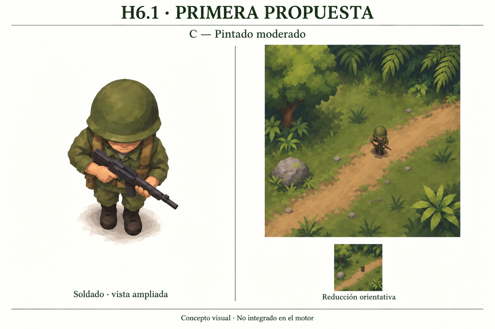
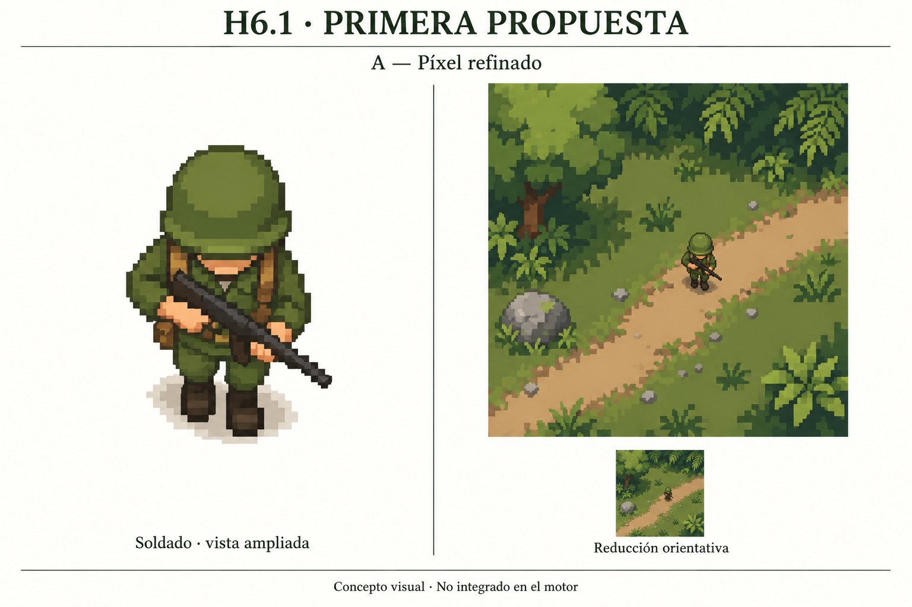
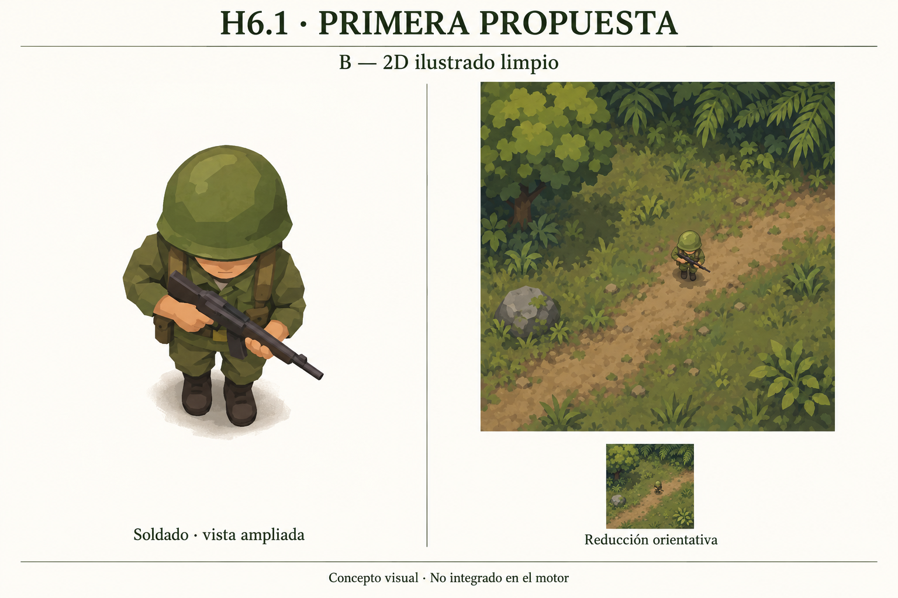

# Bocetos originales — soldado y jungla

Recuperados y archivados sin recodificar el 28-10-2026. Cuatro PNG originales de imagegen, 1536×1024, generados el 26-10 UTC (A/C corresponden al 27-10 en España). El [manifiesto](manifest.json) conserva nombres originales, tamaños y SHA-256. Son arte generado para este proyecto, sin imágenes comerciales de entrada según los briefs; se distribuyen bajo los términos GPL-3.0-or-later del repositorio, como la pose C01.

**Elección definitiva de dirección: C — Pintado moderado.** Miguel: «mi favorito es C, con diferencia»; le gusta su toque Nintendo. A descartada; B no elegida. No confundir aprobación del estilo con aceptación de la pose integrada o de la densidad.

## C01 — Pintado moderado, elegida

## B01 — Ilustrado limpio refinado, no elegido

## A01 — Píxel refinado, descartado

## B00 — Primera versión, histórica

Los briefs y prompts exactos registrados están en [B01](../../../docs/modernization/H6_1_MUESTRA_B01.md) y [comparativa A/B/C](../../../docs/modernization/H6_1_COMPARATIVA_ABC.md). Las pequeñas variaciones geométricas y miniaturas generadas impiden usarlas como comparación instrumentada de píxeles. La jungla dibujada es una referencia conceptual; todavía no hay tiles de producción.

La [pose C01 transparente](../soldier-c01/source.png), su [prompt](../soldier-c01/README.md) y [manifiesto de anclaje](../soldier-c01/manifest.json) se conservan por separado. Es el maestro del piloto: no sustituirlo por un recorte de esta lámina. El cuerpo se integra experimentalmente en 16×14; todavía no hay compositor HD ni atlas de animación. La futura comparación 8×/12× debe mantener pose, cámara, anclaje, fondo y tamaño físico comparables.
