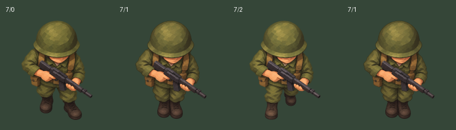

# Ciclo diagonal — preparación interna A3

Tres claves de la dirección 7, ciclo original 0–1–2–1. **No es la sustitución completa de soldados ni una nueva entrega del piloto.** El lanzador y los cinco maestros anteriores se conservan. C01 no se modifica y se deriva con su constructor original.

## Cambio y revisión

El recorte antiguo de 7/2 tenía 942 píxeles de alto, frente a 850 de C01. Al reducir ambos a 14 unidades lógicas, el casco/torso de 7/2 se encogía. Se genera `s7-f2-v2.png` como candidato de zancada opuesta más compacta. Los tres recortes de `review.json` tienen ahora 850 píxeles de alto y el mismo destino de 10×14 unidades. Los límites alfa >=16 de la imagen nueva son (405,174)–(969,1022); recorte explícito (405,174)–(969,1024). La pose central se conserva como maestro provisional con recorte de altura 850. No se reescalan ni retocan los maestros.

Revisión interna de los derivados: casco/torso con escala estable, apoyo izquierdo/derecho alterno, pose intermedia compacta, rifle con la misma orientación. Pequeñas diferencias de pintura entre maestros siguen pendientes de valoración en movimiento. **La correspondencia anatómica con los frames nativos y la aceptación de Miguel siguen pendientes.** No extender estas tres imágenes a otras orientaciones, estados o enemigos.

## Reproducción

`tools/modernization/prepare_walk_art_review.py` reutiliza los tres constructores existentes. Recibe `--c01-builder`, `--batch-builder`, `--asset-builder` y un directorio nuevo `--out`. Genera PNG y RGBA exactos 8×/12×, manifiesto v2, hashes y `review.html` autónomo. No activa ninguna variable del juego. El HTML tiene pausa, paso manual y selección de densidad; sus 180 ms son solo una velocidad de revisión.

`review.json` conserva 13 claves completas observadas (7 PC y 6 Amiga) como **vinculaciones candidatas**, junto con el hash del censo de procedencia. No basta haber observado un recurso para aprobar su apariencia. El manifiesto generado es exclusivamente de desarrollo; faltan el contraste de cada recurso/paleta y el recorrido de campaña. Los casos SDL usan recursos controlados y claves recalculadas; **no ejercitan esas 13 claves de campaña**.

`check_walk_art_review.py`, registrado como CTest `soldier_walk_art_review`, prepara los derivados y recorre el método real `WindowHD` con recursos PC/Amiga controlados, dos variantes de persona/paleta, dos soldados, agua y oclusión. Compara píxeles SDL y conserva la traza transaccional. Verifica también que C01 siga siendo idéntico byte a byte en ambas densidades. El informe permanece PENDING para la aceptación visual y la campaña.

## Procedencia del nuevo maestro

Herramienta integrada `image_gen`, edición con transparencia real. Referencia única: `../soldier-c01/source.png`. Sin gráficos comerciales como entrada, sin retoque posterior del maestro. El original generado se conserva completo en `s7-f2-v2.png`; dimensiones 1353×1162. Los otros dos maestros y su procedencia están en `../soldier-c01` y `../soldier-pilot`.

Prompt final exacto:

> Use case: precise-object-edit. Edit target: the attached accepted C01 soldier game sprite. Create ONE opposite walking stride frame. Preserve exactly the helmet, face, torso, arms, hands, rifle, camera, olive paint texture, brown straps, lighting, scale and position of the input. Change ONLY legs and boots below the belt. In the input the boot on image-right is forward/lower. In the output bring the boot on image-left forward/lower, and draw image-right leg back with its boot higher. A modest compact walking stride, NOT a lunge. Keep both boots within the SAME original full-character bounding box; do NOT elongate the legs or increase character height. Keep the helmet top and forward boot sole at the same vertical positions as the input. Same southeast facing direction; do not mirror the character or the weapon. Entire single soldier, actual transparent background. No shadow, floor, text, extra characters or frame sheet. Preserve original image dimensions 1353 by 1162 and composition if possible. This is an animation production master, consistency takes priority over new detail.

## Pendiente

Preparar/contrastar las otras 21 claves de marcha, revisar variantes de campaña, completar el resto de estados y entidades, transiciones, GPU y CD32. Mantener la aceptación completa abierta; esta revisión aislada no acredita ausencia de alternancia durante el juego.
