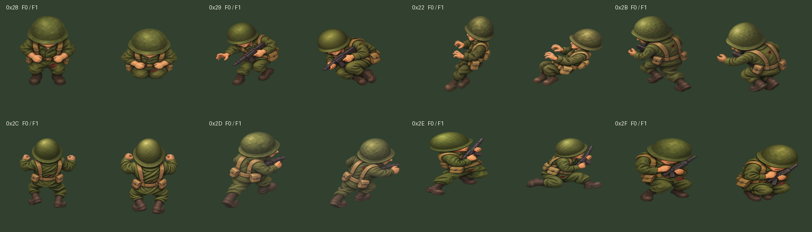

# A.1 — Direcciones de daño/muerte tras aprobar el piloto

17-11-2026. Miguel valora favorablemente F0/F1 de 0x2D y autoriza continuar. Hito de continuidad en curso; una sola dirección por microbloque. Sin cambios de simulación ni activación parcial del lote. [Contrato y proyección](DEMO_A1_DANO_2D.md).

Cada dirección conserva maestro, prompts, derivados 8×/12× y claves verificadas. PASS local Window/SDL con dos cuerpos HD y sombras F0/F1 separadas, alturas 0/12, error SDL con recuperación íntegra, Windows ASan/UBSan y Linux ASan/UBSan/LSan. Las nuevas direcciones esperan revisión agrupada; no se atribuye aceptación visual a las pruebas técnicas. Las claves sin procedencia completa quedan pendientes, sin aprobar por similitud. No se repiten matrices/H3 válidos por arte aislado sin cambio de motor.

| Dirección | Poses | Claves verificadas / pendientes | Casos cuerpo-sombra | Candidato aislado | Evidencia |
|---|---|---|---|---|---|
| 0x2D, atrás/derecha | F0–F1 | 3 / 2 antiguas pendientes de reconstrucción | 24 | 202 / 366 | [Piloto aceptado](DEMO_A1_DANO_2D.md) |
| 0x22 | F0–F1 | 3 / 1 | 24 | 206 / 369 | [Datos](evidence/dano-22-20261117.json) |
| 0x2C | F0–F1 | 3 / 1 | 24 | 210 / 372 | [Datos](evidence/dano-2c-20261117.json) |
| 0x29 | F0–F1 | 3 / 1 | 24 | 214 / 375 | [Datos](evidence/dano-29-20261117.json) |
| 0x2B | F0–F1 | 3 / 2 | 24 | 218 / 378 | [Datos](evidence/dano-2b-20261118.json) |
| 0x28 | F0–F1 | 3 / 0 | 24 | 222 / 381 | [Datos](evidence/dano-28-20261118.json) |
| 0x2E | F0–F1 | 3 / 1 | 24 | 226 / 384 | [Datos](evidence/dano-2e-20261118.json) |
| 0x2F | F0–F1 | 2 / 1 | 16 | 230 / 386 | [Datos](evidence/dano-2f-20261118.json) |

## Punto de control agrupado — 18-11-2026

**Hecho:** las ocho direcciones tienen F0/F1: 16 maestros y 32 activos a 8×/12×, 23 vínculos exactos y **184 casos de pareja cuerpo/sombra** entre Windows y Linux. Arte preparado y publicado por dirección; hito de continuidad **en curso**, sin aceptación jugable. Candidato acumulado aislado `hitdeath-2f-candidate/`: **230 activos / 386 vínculos**. Conserva íntegra la base de granadas 198/363. La simulación y el lanzador normal no se modifican.

Orden de la lámina: frontal, delante/izquierda, izquierda, atrás/izquierda; atrás, atrás/derecha, derecha, delante/derecha. Cada pareja muestra F0/F1. La lámina utiliza los PNG exportados, no los maestros grandes; permite valorar proporciones y transición a la densidad de juego. No acredita todavía oclusiones o animación jugando. Solo el piloto 0x2D tiene valoración favorable explícita de Miguel; las siete direcciones nuevas esperan su revisión conjunta.

### Cobertura medida del candidato real

Se recalculan las tres muestras completas con **las 23 claves verificadas**, no suponiendo cubiertas las nueve antiguas pendientes. Se comprueban primero las métricas base contra el censo anterior. [Evidencia y SHA-256 de entradas](evidence/dano-conjunto-20261118.json).

| Muestra | Base granadas: publicaciones / retornos / rachas ≤3 | Solo arte verificado | Arte + dos dependencias verificadas |
|---|---|---|---|
| Caídas 16:13 | 8.012 / 8 / 0 | 8.393 / 20 / 13 | 8.438 / 5 / 0 |
| Nado 17:32 | 12.937 / 13 / 5 | 13.267 / 16 / 7 | 13.294 / 7 / 0 |
| Impacto 19:54 | 7.276 / 4 / 0 | 7.732 / 13 / 13 | 7.777 / 0 / 4 |

**No activar el arte solo:** empeora la continuidad en las tres muestras. Las dos dependencias son caída 0xB0/F0 animación 1 (mismos bytes/geometría/paleta que la caída aprobada) y jugador 0x7C/F1 animación 6 sin escrituras. Su procedencia y raster ya están reconstruidos, pero **su integración, pruebas de composición y recuperación siguen pendientes**. La última columna es una proyección condicionada; no forma parte del candidato 230/386 ni demuestra que el juego publique esos números.

Las cuatro rachas breves de Impacto terminan en `no-body`, con cero jugadores y sin faltantes, según el análisis retenido del piloto; no se oculta su cuenta bruta ni se confunden con retorno del mismo actor. Las nueve claves antiguas de daño y el marcador invisible antiguo no reconstruido permanecen pendientes. No impiden obtener esta proyección con las claves verificadas y no se aprueban por semejanza.

### Pruebas y límites

- **PASS local:** SDL software a 8×/12×, dos cuerpos HD, sombra independiente F0/F1 a alturas 0/12, composición completa contrastada, clave incorrecta rechazada y recuperación clásica íntegra ante fallo SDL. ASan/UBSan Windows; ASan/UBSan/LSan Linux. Evidencias por dirección en la tabla.
- **PASS conservado:** H3 del binario de granadas, 11 fases / 11.361 estados, sin nueva entrega de ejecutable. No se repite por arte aislado sin activación.
- **CI observada del código/piloto `a0e49174a1cdae76fd5fcf85dde9f2bd827dbb1b`:** [Windows 44184891805](https://github.com/Cacheirez/openfodder/actions/runs/44184891805) y [densidades 44184891793](https://github.com/Cacheirez/openfodder/actions/runs/44184891793) completadas con éxito. [Linux 44184891758](https://github.com/Cacheirez/openfodder/actions/runs/44184891758) seguía en ejecución al consultar, sin paso fallido comunicado; **CI completa Linux PENDIENTE**, sin atribuir verde global ni a los commits artísticos posteriores.
- **PENDIENTE:** valoración agrupada de Miguel; integración de las dos dependencias; publicación real del conjunto/replay; sombras en vuelo por explosión y aceptación jugando; GPU, CD32 y audio. La sombra clásica separada es una convivencia provisional, no coherencia artística final aceptada.

### Relevo y próximos pasos

Commits publicados por dirección: `a0e4917` (piloto), `6273e31` (izquierda y valoración del piloto), `2384ecd` (atrás), `15e5a50` (delante/izquierda), `351ffa7` (atrás/izquierda), `7b26d1b` (frontal), `410f233` (derecha), `6d25dd6` (delante/derecha). El SHA del presente relevo se obtiene con `git log -1 --format=%H -- docs/modernization/DEMO_A1_DANO_DIRECCIONES.md`.

1. **Revisión agrupada de las ocho direcciones — AUTORIZADO, pendiente de valoración visual de Miguel.** Siguiente tarea única: valorar los derivados y la relación F0/F1; señalar direcciones que requieran corrección antes de integrar. No se pide ampliar el hito.
2. **SOMBRAS-HD-PILOTO — AUTORIZADO, condicionado a cerrar la revisión anterior.** Prioridad actualizada por Miguel y publicada en el plan `ea730de` del 18-11: una pose normal de marcha, comparación original Amiga / HD actual / propuesta con sombra recuperada, en estilo C y a 8×/12×. Verificar ancla, máscara, alfa, recorte, terreno/oclusión y ausencia de duplicado con sombras independientes. Sin cambios de motor, simulación ni generación masiva. No iniciado.
3. **Valoración del piloto — REQUIERE APROBACIÓN VISUAL de Miguel.** Decidir sobre la muestra reversible; extender la corrección a otras poses requiere autorización específica. No se presupone aceptación del daño ni del piloto.
4. **Dependencias y conjunto de daño en ejecución — AUTORIZADO dentro del hito, tras los puntos prioritarios anteriores.** Incorporar el alias exacto de caída y el marcador sin escrituras, probar composición/orden, negativos y recuperación; cargar el conjunto coherente y medir publicaciones/retornos reales, presupuesto, H3 y CI pertinentes antes de entregar la prueba jugable. No activar el arte solo.
5. **Revisión jugando — AUTORIZADO, requiere prueba de Miguel.** Daño directo y granadas con varios aliados, caída/vuelo, agua y oclusiones; registrar cualquier alternancia restante. Nuevos escenarios, fase B, scroll y 16:9 siguen fuera de este hito.

**Siguiente acción recomendada:** revisar ahora la lámina conjunta, porque evita integrar y ensayar poses que necesiten corrección artística. Autorización técnica adicional: **no necesaria**. La valoración visual está reservada a Miguel. No hay bloqueo técnico ni escalado de modelo/subagentes. Nuevo hilo: no necesario.

**Revisión operativa del 18-11:** el checkout se actualiza por avance directo al plan remoto `ea730de`, con PR #1 abierta, en borrador y sin fusionar. Sigue pendiente la valoración de las siete direcciones nuevas; el mensaje de continuidad no la sustituye. Plan y Arranque rápido sincronizados con la prioridad del piloto de sombras. No se genera arte, integra el lote ni repiten pruebas por este ajuste documental. Los PASS anteriores siguen siendo evidencia técnica histórica, no aceptación visual/jugable ni comprobaciones nuevas.

**Recuperación:** originales y derivados versionados en `assets/modernization/demo-a1-player-hitdeath-*/`; prompts exactos en cada README. Se empleó `image_gen` integrado. Scripts, fuentes nativas privadas y logs locales en `C:/Users/migue/.codex/visualizations/2026/11/17/01a1ea7b-b727-78f2-a6ac-a4b32dc39150/`: `prepare_hitdeath_native.py`, `export_hitdeath_direction.py`, `finish_hitdeath_direction.py`, `review_damage_group.py`, `run-hitdeath-direction-{win.ps1,linux.sh}`, `death-*-native/` y `hitdeath-*-f*-a*/`. El lanzador comprobado sigue siendo `Probar-P1-Granadas.ps1`; el candidato nuevo no se activa. La copia ZIP previa no relacionada se conserva sin tocar.

## Aprobación recibida — 18-11-2026

Miguel aprueba visualmente las siete direcciones nuevas de daño el 18-11-2026; el piloto 0x2D ya estaba aprobado. No equivale a aceptación jugando ni activa el candidato. Siguiente tarea vigente: SOMBRAS-HD-PILOTO, según el control operativo actualizado. La revisión agrupada anterior queda cerrada.
